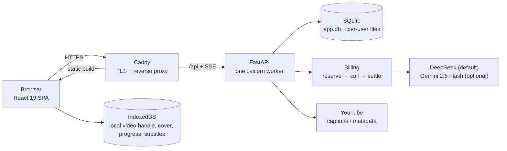

<div align="center">


# LinguaTrek（语途）

**Turn content you already want to watch or read into an English lesson.**

</div>

> **V1 status — invite-only, free web beta (G1, the first beta gate).** Public registration is closed; an invite code is required to create an account. There is no payment or subscription. It is not a public or paid product, and this is not a public launch. This README describes that beta, not a finished commercial product.
>
> **Hosted beta:** the current URL is provided by the operator. This repository uses the placeholder <https://your-domain.example> and intentionally does not publish the live site URL, server address, or credentials. Access requires an invite code from the operator; the URL alone is not enough.
>
> [中文说明](README_zh.md)

## What V1 is

LinguaTrek is a web app for Chinese-speaking learners of English. The interface and translation target also support Vietnamese; Chinese remains the default experience.

### The problem

Learners usually do not lack material. They lose the thread while watching or reading: a word is unknown, the lookup pulls them out of the page, and the session turns into tab-hopping. LinguaTrek keeps the lookup, the explanation, and the review loop on the same surface as the content.

### The learning loop

1. **Choose content** — a YouTube video, an article, a public-domain book, a free-library item, a local SRT episode, or a video file opened from the browser.
2. **Work through it with support** — synchronized bilingual subtitles, CEFR-aware word highlighting, language notes, click-to-define, and dictation.
3. **Save and review** — collect words, then review them with an FSRS scheduler.
4. **Check understanding** — comprehension questions, exam practice, a placement test, an ability profile, and a weekly report.

### Feature groups

#### Video and listening

- **YouTube lessons:** bilingual subtitles translated over SSE; the stream resumes from a job cursor after a disconnect. The active sentence follows playback, and clicking a sentence seeks the video.
- **CEFR-aware highlighting:** choose an A1–C2 level; words above that level are highlighted. Language points, idioms, and culture notes are generated per content item, level, and target language, then cached.
- **Click-to-define:** IPA, part of speech, a context-aware Chinese gloss, an English definition, an example, pronunciation, and one-click save to the vocabulary book. Repeated lookups reuse the cache.
- **Dictation and playback controls:** blur the English and check by ear; sentence loop, speed, and keyboard controls are available.
- **History and resume:** watch history, saved positions, and an explicit resume path.
- **Local shows:** import your own SRT/VTT episodes and read them bilingually with the same lookup tools.
- **Local video:** open a video file in the browser. The file stays in the tab; its handle, cover, progress, and subtitles live in IndexedDB. Persistent handles require a Chromium secure context. Only subtitle text is sent to the backend for translation.
- **Free library:** a small curated set of videos with prebuilt bilingual subtitles and original bilingual articles; loading the content itself does not call a model.

#### Reading

- **Article import:** paste a URL or the article body; the backend extracts paragraphs, translates them paragraph by paragraph, and stores reading progress.
- **Public-domain books:** built-in books plus Project Gutenberg / Standard Ebooks imports, with on-demand chapter translation.
- **Local EPUB upload:** upload a DRM-free EPUB you have the rights to use; chapters and cover stay private to the account.
- **Blog and RSS:** the official blog is rendered from repository Markdown, and an RSS 2.0 feed is available.

#### Review and practice

- **FSRS review:** word states, a due queue, review logs, stats, and automatic suspension after repeated failures. FSRS-6 is deterministic (target retention 0.9).
- **Vocabulary book:** saved words with CEFR/exam word-list views, a hidden-Chinese mode, and Anki/CSV export.
- **Comprehension questions:** three English questions per lesson, with evidence links that jump back to the relevant subtitle moment.
- **Exam practice:** CET-4-style practice from self-authored items; it reports answers and explanations, not a projected score.
- **Placement and ability profile:** a short placement test produces a vocabulary band with an uncertainty interval. Reading, listening, speaking, writing, and grammar are explicitly marked as insufficient or not measured rather than guessed.
- **Sentence packs:** a separate mode for memorizing curated, idiomatic sentences.
- **Weekly report and behavior events:** watch events plus lookup/replay/rate/visibility events feed a rule-based weekly report.

#### Account and billing

- Invite-code registration, login, sessions, a **$2.00** signup credit, per-user data isolation, a balance ledger, and admin top-ups.
- Data export as a ZIP and account deletion with a 7-day cooling-off period.
- No self-serve payment, subscription, or top-up.

#### Operations

- An admin console/API for users, usage, health, invites, balances, settings, and audit records. Admin access is controlled by an email allowlist.
- Structured request/error logs, a readiness endpoint, and Feishu alert hooks.
- Docker Compose and Caddy deployment files, a systemd unit, backup/restore scripts, and production env templates.

## Tech stack and architecture

| Layer | Stack |
|---|---|
| Frontend | React 19, TypeScript, Vite 7, Tailwind CSS 3, framer-motion |
| Backend | FastAPI on Python 3.12, SQLite with Alembic migrations, Server-Sent Events (SSE) |
| AI | DeepSeek Chat by default; Gemini 2.5 Flash as an optional priced model; one model adapter with billing built in |
| Runtime | Docker Compose + Caddy, or systemd + Caddy; exactly one uvicorn worker per instance |



- The SPA uses only the LinguaTrek API for application data; the browser never calls an AI provider directly.
- SSE keeps the translation stream open; a 15-second heartbeat keeps proxies from dropping idle connections, and a job id/cursor lets a reconnect continue instead of paying twice.
- SQLite is the only database. Rate limits, caches, and the model concurrency gate are in-process. That is why the deployment is deliberately single-worker and must not be scaled horizontally.
- All AI calls pass through `backend/llm.py` and the billing layer: reserve before the call, settle against actual usage after it, release the hold on failure.
- In the Docker image, FastAPI also serves the built SPA; on a bare-metal VPS, the Caddyfile serves `frontend/dist` directly and proxies `/api`.
- A local video file never leaves the browser. Only its subtitle text is posted to the backend for translation.

### AI model policy

- **DeepSeek Chat (`deepseek-chat`) is the default.** It is the intended mainland-China deployment model and has a seeded price row; the price still needs a vendor-bill reconciliation.
- **Gemini 2.5 Flash is the optional overseas model.** It requires `GEMINI_API_KEY` and has a price row. Gemini is not reachable or compliant in mainland China, so leave it empty for China deployments.
- **Qwen Flash/Plus and Gemini 3.x entries are cataloged but unpriced.** Strict billing rejects them with `503 model_unpriced`, and they are not in the default routes. They must not be called until a verifiable price is added.
- Model routes (`MODEL_ROUTE_ZH_CN`, `MODEL_ROUTE_VI_VN`) may contain only models with a price row.

## Repository layout

| Path | Contents |
|---|---|
| `frontend/` | React SPA: video/reading/review UI, i18n, browser-local media, installable app-shell assets |
| `backend/` | FastAPI app, SSE pipeline, auth/accounts, billing, AI adapters, SQLite migrations, offline tests |
| `specs/` | 35 feature specifications in spec-kit style; `specs/README.md` is the index |
| `docs/` | Architecture, design language, development guide, deployment/runbook, reports |
| `deploy/` | Docker/Caddy production files, systemd unit, cron jobs, env templates |
| `scripts/` | Content builds, QA/browser checks, backup/restore, preflight, maintenance scripts |
| `content/` | Curated subtitles, free library, public-domain books, placement/exam banks, sentence packs, blog Markdown |

There is also a `mobile/` Expo client. It is not at feature parity and is not part of the V1 web beta.

## Quick start

### Prerequisites

- Node.js 22
- Python 3.12
- A [DeepSeek API key](https://platform.deepseek.com/api_keys) for the default model
- Git and npm

Docker is only needed for the deployment path.

### Run locally

```bash
git clone https://github.com/XuehaiQiao/yt-bilingual-app.git
cd yt-bilingual-app

./setup.sh
cp .env.example .env
# Edit .env and set DEEPSEEK_API_KEY. Gemini is optional and overseas-only.
```

Backend (terminal 1):

```bash
cd backend
source venv/bin/activate
alembic upgrade head
uvicorn main:app --reload --port 8000
```

Frontend (terminal 2):

```bash
cd frontend
npm run dev
```

Open **http://127.0.0.1:5173**. Use `127.0.0.1` consistently; if you mix `localhost` and `127.0.0.1`, the browser treats them as different sites and will not send the `SameSite=Lax` session cookie.

On macOS, `./start_app.command` is a shortcut after the first migration. It starts both processes and opens the app.

### Local accounts and invite codes

Registration is closed by default: `REGISTRATION_OPEN=false` and `INVITE_SIGNUP_ENABLED=true`. A fresh local database has no account to bootstrap from. Pick one of these local-only options:

**Option A — local development switch (simplest):**

```dotenv
# .env — local development only
REGISTRATION_OPEN=true
```

Restart the backend, sign up, then set it back to `false`. Never enable this on the hosted instance; it would open public signup.

**Option B — generate a local invite code directly:**

```bash
cd backend
venv/bin/alembic upgrade head
venv/bin/python -c 'import invites; print(invites.create_invites("local-dev")[0]["code"])'
```

Run it against the same `AUTH_DB_PATH` as the server. The code is printed once; the database stores only an HMAC digest. Copy it into the sign-up form. On the hosted instance, codes come from the admin console/API; this direct command is only a local bootstrap.

To use the admin console locally, put your account email in `ADMIN_EMAILS` and restart the backend.

### First-run check

```bash
curl -fsS http://127.0.0.1:8000/healthz
```

Run the migration before starting the app; the readiness endpoint exposes the database and migration state. If `db.migrations.current` differs from `db.migrations.head`, run `alembic upgrade head`.

## Configuration

Copy `.env.example` to `.env`; production uses `deploy/production.env.example` as the template.

| Variable | Default | Notes |
|---|---|---|
| `DEEPSEEK_API_KEY` | empty | Required for the default model. Without it, DeepSeek is unavailable. |
| `GEMINI_API_KEY` | empty | Optional, overseas only. Enables Gemini 2.5 Flash; do not use Gemini in mainland China. |
| `DEFAULT_MODEL` | `deepseek-chat` | Global fallback model id. Unknown values fall back to `deepseek-chat`. |
| `BILLING_STRICT` | `1` | Keep `1`. Every AI call needs a logged-in user and a price row; `0` is a rollback-only escape hatch. |
| `MODEL_ROUTE_ZH_CN` | `deepseek-chat,gemini-2.5-flash` | Ordered route for Chinese; only priced models. Unset keys are skipped. |
| `MODEL_ROUTE_VI_VN` | `deepseek-chat` | Ordered route for Vietnamese; Qwen is absent because it has no price row. |
| `CORS_ORIGINS` | `*` locally | Set the exact public origin before deployment. Do not ship `*` to production. |
| `COOKIE_SECURE` | `0` | Set to `1` behind HTTPS so the session cookie gets the `Secure` flag. |
| `VITE_API_BASE` | `http://127.0.0.1:8000` | Build-time frontend API origin. Production must build with the real HTTPS origin (placeholder: `https://your-domain.example`). |
| `API_AUTH_KEY` | empty | **Do not set for the hosted browser UI.** It gates all `/api`, including `/api/auth/*`, so browser logins fail with 401. Never put it in `VITE_API_KEY`; Vite variables are embedded in the public bundle. |
| `REGISTRATION_OPEN` | `false` | Hosted G1 stays `false`. `true` is G2 public signup and must not be used for this beta. |
| `INVITE_SIGNUP_ENABLED` | `true` | With `REGISTRATION_OPEN=false`, invite-code signup is enabled. Setting both to `false` closes all new accounts while leaving login working. |
| `ADMIN_EMAILS` | empty | Comma-separated admin email allowlist. Empty means no admin endpoints are available. |
| `SIGNUP_BONUS_MICRO_USD` | `2000000` | $2.00 signup credit, stored as integer micro-USD. `0` disables it. |

> **Hard rules:** never commit `.env`, `data/`, `history/`, or `subtitles/`; do not set `API_AUTH_KEY` or `VITE_API_KEY` for the hosted browser deployment; set `COOKIE_SECURE=1` behind HTTPS; keep `BILLING_STRICT=1`.

## Security, privacy, and billing

### AI access and strict billing

- **Every endpoint that triggers an AI call requires login.** Guests and anonymous requests get `403 {"code":"login_required"}`. This is deliberately 403 rather than 401 so the frontend does not log the user out.
- **Strict billing is on by default.** Money is stored as integer micro-USD (1 USD = 1,000,000 µUSD). A call reserves against the balance, calls the model, then settles against actual usage; failures release the hold.
- **Balance and quota are separate limits.** Insufficient balance returns `402 insufficient_balance`; daily quota or budget limits return `429 quota_exceeded` / `429 budget_exceeded`.
- **An unpriced model is never called.** It returns `503 model_unpriced`. Qwen and Gemini 3.x are in this state today.
- **Cached and public reads are free.** Opening public library items, reading cached public-book chapters, or reopening saved history does not itself trigger AI or a charge.

### Accounts and data lifecycle

- Registration is invite-only; the code is single-use/time-limited by default, and the database stores only a digest.
- Passwords use Argon2id hashes. The session cookie is `HttpOnly`, `SameSite=Lax`, and valid for 30 days; the server stores only a token hash.
- New accounts receive a $2.00 credit. There is no card payment, subscription, or self-serve top-up; an admin adjusts balances manually.
- Users can export their data as a ZIP (JSON plus user files) and request account deletion. Deletion has a 7-day cooling-off period; submitting it immediately stops AI calls and new learning-data writes, and the user can cancel during the window.
- Per-user data lives under `data/users/<user_id>/`; guest data lives under `data/guests/<sha256>/`. Requests are scoped to the current account or guest and do not read another user's files.
- Local backups contain account data and Argon2id password hashes. They are local-only by default; there is no off-site copy. After the cooling-off period, hard deletion removes live data; local backups may still retain account data until they age out.
- Admin access is protected by the `ADMIN_EMAILS` allowlist; sensitive operations are written to an audit log.

### Local video and third-party content

- A local video file is played from a browser object URL and is **never uploaded**. IndexedDB stores the file handle, cover, playback position, and subtitle text.
- The subtitle text **is sent to the backend and then to the configured AI provider** for translation. Do not treat local video as fully offline.
- YouTube captions/metadata are fetched from YouTube. Public-domain book text is fetched from its source and is not committed to the repository. Subtitle files and personal learning history are gitignored.

### Operations

- Structured JSON logs include a request id and user id, but not query strings, bodies, or secrets.
- The Feishu alert hooks cover 5xx responses, billing settlement failures, budget thresholds, backup failures, and health checks.
- **Current gap:** the hosted Feishu webhook is not configured with a signing secret. See [Known limitations](#known-limitations-and-roadmap).

## Testing and quality

```bash
# Backend: syntax check + offline test suite
cd backend
venv/bin/python -m py_compile *.py
venv/bin/python -m pytest tests -q

# Frontend: type check, production build, i18n key check
cd frontend
npx tsc -b
npm run build
npm run check:i18n
```

**Status at the time of this revision:** `pytest --collect-only` collects **1,243 backend tests**, and the latest full run reported them passing. The frontend type check, production build, and i18n check pass. A hosted-beta smoke test of the core path (temporary invite account) passed.

These are snapshots, not a permanent guarantee. The suite is large and changes with every feature; run it in your environment before relying on a number. The hosted smoke test was a narrow core-path check, not a full regression, load test, or launch certification.

## Deployment

Two supported layouts:

1. **Docker Compose + Caddy** — one app container, a named `/data` volume, Caddy terminating TLS on the host.
2. **Bare metal + systemd + Caddy** — the unit in `deploy/linguatrek.service`, with Caddy serving `frontend/dist`.

Both use **one uvicorn worker**. SQLite has a single writer, and rate limits/caches live in process; do not scale to multiple replicas or workers.

Before first start, run the migration (`alembic upgrade head`) and verify `/healthz`. Back up `/data` (Docker) or `data/` (bare metal) before upgrades. `scripts/backup.sh` produces a WAL-safe SQLite snapshot plus user data; `scripts/restore.sh` and `restore_drill.sh` cover restore and a drill. Local rotation defaults to seven archives.

Step-by-step instructions:

- [Deployment execution runbook (G1)](docs/部署执行手册-linguatrekai.online.md)
- [Launch steps and checklists (G1)](docs/上线步骤-linguatrekai.online.md)
- [General deployment guide](docs/部署指南.md)

The README intentionally uses a placeholder for the live site URL and omits the server address and provider credentials. Use `deploy/production.env.example` and keep the env file at mode `600`.

## Known limitations and roadmap

### Not in V1

- Payments, subscriptions, and self-serve top-ups. The beta is free and invite-only.
- Public registration. This is a G1 policy, not a bug.
- Email verification, password reset/change, self-serve session revocation, and a guardian/minor consent flow.
- PWA/offline learning beyond the installable app shell; lessons still need the backend.
- Mobile parity. The `mobile/` Expo client is not at feature parity; V1 is web-first.
- Multi-node/HA deployment. The architecture is intentionally single-node, single-worker SQLite.
- An SLA or 24×7 support. The beta is supported manually through the inviter/admin.

### Open before calling it launch-ready

- **Off-site backup is not configured.** Local tar.gz archives protect against accidental deletion, not disk failure or hosting-provider loss.
- **The 30-minute SSE path has not had final QA.** Short streams were verified; a long stream through the production proxy still needs a real test.
- **The full UI/browser/device matrix, including the admin console UI, has not had final QA.**
- **Legal review of the privacy policy and terms is pending.**
- **The DeepSeek price has not been reconciled against a vendor bill.** The ledger uses the seeded price row.
- **The hosted Feishu webhook has no signing secret configured, and signed delivery has not been verified.**

Roadmap items above are known work, not delivery promises.

## Documentation

All project documentation except the two root READMEs is in Chinese.

| Document | Contents |
|---|---|
| [specs/README.md](specs/README.md) | Index of 35 feature specifications |
| [docs/README.md](docs/README.md) | Documentation map |
| [docs/架构.md](docs/架构.md) | System architecture and data flow |
| [docs/开发指南.md](docs/开发指南.md) | Local setup, env vars, migrations, spec-driven workflow |
| [docs/部署指南.md](docs/部署指南.md) | Docker/bare-metal deployment, TLS, backup, restore, rollback |
| [docs/运行手册.md](docs/运行手册.md) | Operations, incident handling, backup and alerting |
| [CONSTITUTION.md](CONSTITUTION.md) | Seven product and engineering principles |
| [AGENTS.md](AGENTS.md) | Entry point for AI coding agents and hard project rules |

## Contributing and license

Contributions are welcome. Read [AGENTS.md](AGENTS.md) and [CONSTITUTION.md](CONSTITUTION.md) first, keep the relevant spec in sync with behavior changes, and run the backend/frontend checks above before opening a PR. Do not commit secrets, personal learning data, or third-party subtitle files.

MIT — see [LICENSE](LICENSE).
