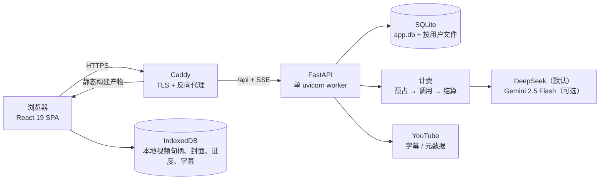

<div align="center">


# 语途（LinguaTrek）

**把你本来就想看、想读的内容，变成一堂英语课。**

</div>

> **V1 状态 —— 邀请制免费 Web 内测（G1，首个内测阶段）。** 公开注册关闭；创建账号必须持邀请码。当前没有支付与订阅。这不是公开或付费产品，也不是正式公开发布。本文描述的是这个内测版本，而不是已经完成的商业产品。
>
> **线上内测：** 当前地址由运营者提供。仓库里使用占位地址 <https://your-domain.example>，不写线上站点 URL、服务器地址或凭据。访问还需要运营者发放的邀请码，光有地址不够。
>
> [English](README.md)

## V1 是什么

语途是一个面向中文母语英语学习者的 Web 应用；界面与翻译目标语言也支持越南语，中文仍是默认体验。

### 解决什么问题

学习者通常不缺材料，缺的是不被打断的观看/阅读体验：遇到生词就查，查完就离开页面，一次学习就变成在多个标签页之间来回跳。语途把查词、讲解和复习放回内容所在的同一个界面。

### 核心学习闭环

1. **选内容** —— YouTube 视频、文章、公版书、免费资源库、本地 SRT 剧集，或从浏览器打开的本地视频。
2. **在辅助下看/读** —— 同步双语字幕、CEFR 词级高亮、语言点、点词查词、听写。
3. **收藏与复习** —— 生词本 + FSRS 调度。
4. **检验理解** —— 理解题、考试练习、定位测、能力画像、周报。

### 功能分组

#### 视频与精听

- **YouTube 课程：** SSE 流式生成双语字幕；断线后按 job cursor 续传。当前句跟随播放，点句跳转。
- **CEFR 词级高亮：** 选择 A1–C2 水平，只高亮超出该水平的词。语言点、习语、文化点按「内容 + 等级 + 目标语言」生成并缓存。
- **点词查词：** 音标、词性、语境中文释义、英文释义、例句、发音、一键收藏；重复查询复用缓存。
- **听写与播放控制：** 模糊英文做听写；单句循环、倍速、键盘操作。
- **历史与续播：** 观看历史、保存进度、明确的续播路径。
- **本地剧集：** 导入自己的 SRT/VTT 剧集，用同一套查词工具双语阅读。
- **本地视频：** 在浏览器中打开本地视频文件；文件留在标签页内，句柄、封面、进度、字幕存 IndexedDB。持久句柄依赖 Chromium 安全上下文。只有字幕文本发给后端做翻译。
- **免费资源库：** 少量精选视频（预置双语字幕）与原创双语短文；内容加载本身不调用模型。

#### 阅读

- **文章导入：** 粘贴 URL 或正文；后端抽取段落、逐段翻译、保存阅读进度。
- **公版书：** 内置书 + Project Gutenberg / Standard Ebooks 导入；章节按需翻译。
- **本地 EPUB 上传：** 上传无 DRM、自己有使用权的 EPUB；章节与封面仅账号可见。
- **博客与 RSS：** 仓库 Markdown 渲染的官方博客 + RSS 2.0。

#### 复习与练习

- **FSRS 复习：** 词状态、到期队列、复习日志、统计；连续失败自动暂停。FSRS-6 确定性调度，目标保持率 0.9。
- **生词本：** 收藏词 + CEFR/考试词表视图、隐藏中文、Anki/CSV 导出。
- **理解题：** 每课 3 道英文理解题，答错回到字幕证据所在的时间点。
- **考试练习：** CET-4 风格自编题；给出答案与解析，不预测分数。
- **定位测与能力画像：** 短测给出词汇区间与不确定区间；阅读、听力、口语、写作、语法明确标为证据不足或未测，不猜。
- **句子精背：** 单独的精选句背诵模式。
- **周报与行为埋点：** 观看事件 + 查词/回放/倍速/可见性事件 → 规则周报。

#### 账号与计费

- 邀请码注册、登录、会话、**$2.00** 开户余额、按用户隔离数据、余额流水、管理员调账。
- ZIP 数据导出；账号删除 7 天冷静期。
- 没有自助支付、订阅或充值。

#### 运营

- 管理后台/API：用户、用量、健康、邀请码、余额、设置、审计。管理员由邮箱白名单控制。
- 结构化请求/错误日志、就绪检查、飞书告警钩子。
- Docker Compose/Caddy、systemd、备份恢复脚本、生产 env 模板。

## 技术栈与架构

| 层 | 技术 |
|---|---|
| 前端 | React 19、TypeScript、Vite 7、Tailwind CSS 3、framer-motion |
| 后端 | FastAPI、Python 3.12、SQLite + Alembic 迁移、Server-Sent Events（SSE） |
| AI | 默认 DeepSeek Chat；Gemini 2.5 Flash 为可选有价模型；统一模型适配层内置计费 |
| 运行 | Docker Compose + Caddy，或 systemd + Caddy；每实例一个 uvicorn worker |



- SPA 的应用数据只走语途 API；浏览器不直接调用模型厂商。
- SSE 保持翻译流打开；15 秒心跳防止代理断掉空闲连接，job id/cursor 让断线续传，避免重复付费。
- SQLite 是唯一数据库；限流、缓存、模型并发闸都在进程内。因此部署固定单 worker，不能水平扩容。
- 所有 AI 调用经 `backend/llm.py` 与计费层：调用前预占、调用后按实际 usage 结算、失败释放。
- Docker 镜像内 FastAPI 同时服务构建后的 SPA；裸机部署由 Caddy 直接服务 `frontend/dist` 并反代 `/api`。
- 本地视频文件不上传；只有字幕文本发给后端翻译。

### AI 模型策略

- **DeepSeek Chat（`deepseek-chat`）是默认模型。** 面向中国大陆部署；已有价格行，但仍需厂商账单复核。
- **Gemini 2.5 Flash 是海外可选项。** 需配置 `GEMINI_API_KEY`，已有价格行；Gemini 在大陆不可用/不合规，大陆部署请留空。
- **Qwen Flash/Plus 与 Gemini 3.x 在模型目录里但没有价格。** 严格计费会以 `503 model_unpriced` 拒绝，默认路线也不包含它们；没有可核实价格前不得调用。
- 模型路线（`MODEL_ROUTE_ZH_CN`、`MODEL_ROUTE_VI_VN`）只能含有价格行的模型。

## 仓库结构

| 路径 | 内容 |
|---|---|
| `frontend/` | React SPA：视频/阅读/复习 UI、i18n、浏览器本地媒体、可安装应用壳资源 |
| `backend/` | FastAPI、SSE 管线、账号/鉴权、计费、AI 适配层、SQLite 迁移、离线测试 |
| `specs/` | 35 份 spec-kit 风格功能规格；索引在 `specs/README.md` |
| `docs/` | 架构、设计语言、开发指南、部署/运行手册、报告 |
| `deploy/` | Docker/Caddy 生产文件、systemd unit、cron、env 模板 |
| `scripts/` | 内容构建、QA/浏览器检查、备份恢复、preflight、维护脚本 |
| `content/` | 精选字幕、免费资源库、公版书、定位测/考试题库、句子精背、博客 Markdown |

另有一个 `mobile/` Expo 客户端，功能未对齐，不属于 V1 Web 内测。

## 快速开始

### 环境要求

- Node.js 22
- Python 3.12
- 一个 [DeepSeek API Key](https://platform.deepseek.com/api_keys)（默认模型）
- Git 与 npm

只有部署路径需要 Docker。

### 本地运行

```bash
git clone https://github.com/XuehaiQiao/yt-bilingual-app.git
cd yt-bilingual-app

./setup.sh
cp .env.example .env
# 编辑 .env，填入 DEEPSEEK_API_KEY；Gemini 可选，仅海外。
```

后端（终端 1）：

```bash
cd backend
source venv/bin/activate
alembic upgrade head
uvicorn main:app --reload --port 8000
```

前端（终端 2）：

```bash
cd frontend
npm run dev
```

打开 **http://127.0.0.1:5173**。前后端统一用 `127.0.0.1`；混用 `localhost` 与 `127.0.0.1` 会被浏览器视为不同站点，`SameSite=Lax` 会话 Cookie 不会发送。

macOS 上首次迁移后可用 `./start_app.command` 一键启动前后端并打开页面。

### 本地账号与邀请码

默认注册关闭：`REGISTRATION_OPEN=false`、`INVITE_SIGNUP_ENABLED=true`。全新的本地库没有可引导的账号，二选一：

**方式 A —— 本地开发开关（最简单）：**

```dotenv
# .env —— 仅本地开发
REGISTRATION_OPEN=true
```

重启后端、注册，再改回 `false`。不要在内测线上实例打开；那会变成公开注册。

**方式 B —— 直接生成本地邀请码：**

```bash
cd backend
venv/bin/alembic upgrade head
venv/bin/python -c 'import invites; print(invites.create_invites("local-dev")[0]["code"])'
```

对同一个 `AUTH_DB_PATH` 运行。明文只打印一次，数据库只存 HMAC 摘要。把码填进注册表单即可。线上邀请码由管理后台/API 生成；这条命令仅用于本地引导。

本地要用管理后台：把账号邮箱写进 `ADMIN_EMAILS`，重启后端。

### 首次检查

```bash
curl -fsS http://127.0.0.1:8000/healthz
```

启动前先跑迁移；就绪检查会暴露数据库与迁移状态。若 `db.migrations.current` 与 `db.migrations.head` 不一致，跑 `alembic upgrade head`。

## 配置

从 `.env.example` 复制 `.env`；生产以 `deploy/production.env.example` 为模板。

| 变量 | 默认值 | 说明 |
|---|---|---|
| `DEEPSEEK_API_KEY` | 空 | 默认模型必填。不配则 DeepSeek 不可用。 |
| `GEMINI_API_KEY` | 空 | 可选，仅海外。启用 Gemini 2.5 Flash；大陆不要使用 Gemini。 |
| `DEFAULT_MODEL` | `deepseek-chat` | 全局兜底模型 id；未知值回落到 `deepseek-chat`。 |
| `BILLING_STRICT` | `1` | 保持 `1`。每次 AI 调用都要求登录用户与价格行；`0` 仅作回滚逃生门。 |
| `MODEL_ROUTE_ZH_CN` | `deepseek-chat,gemini-2.5-flash` | 中文目标语言路线；只能含有价格行的模型，未配 Key 的候选自动跳过。 |
| `MODEL_ROUTE_VI_VN` | `deepseek-chat` | 越南语目标语言路线；Qwen 无价格，已移除。 |
| `CORS_ORIGINS` | 本地 `*` | 公网部署前必须设为精确来源，不要把 `*` 带上生产。 |
| `COOKIE_SECURE` | `0` | HTTPS 下设 `1`，会话 Cookie 加 `Secure`。 |
| `VITE_API_BASE` | `http://127.0.0.1:8000` | 前端构建期 API 源。生产必须用真实的 HTTPS 源构建（占位：`https://your-domain.example`）。 |
| `API_AUTH_KEY` | 空 | **公网浏览器 UI 不要设置。** 它会拦住所有 `/api`（含 `/api/auth/*`），浏览器登录会 401。也不要写进 `VITE_API_KEY`；Vite 变量会打进公开 bundle。 |
| `REGISTRATION_OPEN` | `false` | 内测 G1 保持 `false`；`true` 是 G2 公开注册，不适用于本内测。 |
| `INVITE_SIGNUP_ENABLED` | `true` | 与 `REGISTRATION_OPEN=false` 配合开启邀请码注册；两个都设 `false` 会关闭新账号创建，登录不受影响。 |
| `ADMIN_EMAILS` | 空 | 管理员邮箱白名单，逗号分隔；为空时后台端点不可用。 |
| `SIGNUP_BONUS_MICRO_USD` | `2000000` | $2.00 开户余额，整数微美元；`0` 表示不发。 |

> **硬规则：** 不要提交 `.env`、`data/`、`history/`、`subtitles/`；公网浏览器部署不要设 `API_AUTH_KEY` 与 `VITE_API_KEY`；HTTPS 下设 `COOKIE_SECURE=1`；保持 `BILLING_STRICT=1`。

## 安全、隐私与计费

### AI 入口与严格计费

- **所有会触发 AI 的入口都必须登录。** 游客/匿名请求返回 `403 {"code":"login_required"}`；不用 401，避免前端误判为会话失效而登出。
- **严格计费默认开启。** 金额一律整数微美元（1 USD = 1,000,000 µUSD）。调用前按余额预占，调用后按实际 usage 结算，失败释放。
- **余额与配额是两道独立限制。** 余额不足返回 `402 insufficient_balance`；日配额/预算超限返回 `429 quota_exceeded` / `429 budget_exceeded`。
- **没有价格行的模型不会被调用。** 返回 `503 model_unpriced`；Qwen 与 Gemini 3.x 当前属于这一类。
- **缓存与公开读取免费。** 打开免费资源库内容、读取已缓存的公版书章节或重新打开已保存的历史，本身不触发 AI，也不扣费。

### 账号与数据生命周期

- 注册必须持邀请码；邀请码默认限次、限时，数据库只存摘要。
- 密码用 Argon2id 哈希；会话 Cookie 为 `HttpOnly`、`SameSite=Lax`、30 天，服务端只存 token 哈希。
- 新账号送 $2.00。没有银行卡支付、订阅或自助充值；余额由管理员手工调整。
- 用户可以导出 ZIP（JSON + 用户文件），也可以申请删除账号。删除有 7 天冷静期：提交后立即停止 AI 调用与新学习数据写入，期间可取消。
- 用户数据在 `data/users/<user_id>/`，游客数据在 `data/guests/<sha256>/`；请求按当前账号或游客隔离，不读别人的文件。
- 本机备份包含账号数据与密码哈希（Argon2id）；默认只在本机，没有离机副本。冷静期结束后的硬删除会清理在线数据，但本机备份可能保留到轮换过期。
- 后台由 `ADMIN_EMAILS` 白名单保护，敏感操作写审计记录。

### 本地视频与第三方内容

- 本地视频文件从浏览器 object URL 播放，**不会上传**。IndexedDB 保存文件句柄、封面、播放进度与字幕文本。
- 字幕文本**会发给后端，再发给配置的 AI 厂商**做翻译。不要把本地视频当成完全离线功能。
- YouTube 字幕/元数据从 YouTube 抓取；公版书原文从来源站实时抓取，不提交进仓库。字幕文件与个人学习历史均在 `.gitignore` 中。

### 运营

- 结构化 JSON 日志包含 request id 与 user id，不记录 query、body 或密钥。
- 飞书告警钩子覆盖 5xx、结算失败、预算阈值、备份失败与健康检查。
- **当前缺口：** 线上飞书 webhook 未配置签名密钥。见[已知限制](#已知限制与路线图)。

## 测试与质量

```bash
# 后端：语法检查 + 离线测试
cd backend
venv/bin/python -m py_compile *.py
venv/bin/python -m pytest tests -q

# 前端：类型检查、生产构建、i18n key 检查
cd frontend
npx tsc -b
npm run build
npm run check:i18n
```

**截至本次修订：** `pytest --collect-only` 收集 **1,243 个后端测试**，最近一次全量报告全部通过；前端 tsc/build/i18n 通过；线上内测核心链路已用临时邀请账号跑通 smoke 测试。

这些是快照，不承诺永久全绿。测试会随功能变化，请在本机重跑后再依赖具体数字。线上 smoke 是窄核心链路检查，不是全量回归、压测或上线认证。

## 部署

支持两种方式：

1. **Docker Compose + Caddy** —— 一个应用容器、命名 `/data` 卷，宿主机 Caddy 终止 TLS。
2. **裸机 + systemd + Caddy** —— 用 `deploy/linguatrek.service`，Caddy 直接服务 `frontend/dist`。

两种方式都固定 **一个 uvicorn worker**。SQLite 单写进程，限流/缓存也在进程内，不能扩成多副本或多 worker。

首次启动前跑迁移（`alembic upgrade head`）并验证 `/healthz`。升级前备份 `/data`（Docker）或 `data/`（裸机）。`scripts/backup.sh` 生成 WAL 安全的 SQLite 快照与用户数据；`scripts/restore.sh` 与 `restore_drill.sh` 覆盖恢复和演练；本地默认保留 7 份。

逐步操作：

- [部署执行手册（G1）](docs/部署执行手册-linguatrekai.online.md)
- [上线步骤与检查清单（G1）](docs/上线步骤-linguatrekai.online.md)
- [通用部署指南](docs/部署指南.md)

README 对线上站点使用占位地址，不写服务器地址与厂商凭据。生产用 `deploy/production.env.example`，env 文件权限保持 `600`。

## 已知限制与路线图

### V1 不做

- 支付、订阅、自助充值。内测免费且仅限邀请。
- 公开注册。这是 G1 策略，不是缺陷。
- 邮箱验证、找回/修改密码、自助会话吊销、未成年/监护人同意流程。
- 可安装应用壳之外的 PWA/离线学习；课程仍需要后端。
- 移动端功能对齐。`mobile/` Expo 客户端未对齐，V1 以 Web 为先。
- 多节点/高可用部署。当前架构是有意为之的单节点、单 worker SQLite。
- SLA 或 24×7 支持。内测由邀请人/管理员人工支持。

### 对外称「可上线」之前仍需完成

- **离机备份未配置。** 本机 tar.gz 能防误删，不能防磁盘或机房故障。
- **30 分钟长 SSE 未做最终 QA。** 短视频流验证过；通过生产代理的长流仍需实测。
- **完整 UI/浏览器/设备矩阵（含管理后台 UI）未做最终 QA。**
- **隐私政策与条款尚未完成法务复核。**
- **DeepSeek 价格尚未与厂商账单核对。** 账本使用的是 seed 价格行。
- **线上飞书 webhook 尚未配置签名密钥，签名投递也尚未验证。**

以上路线图是已知工作项，不是交付承诺。

## 文档索引

除根目录两份 README 外，项目文档均为中文。

| 文档 | 内容 |
|---|---|
| [specs/README.md](specs/README.md) | 35 份功能规格索引 |
| [docs/README.md](docs/README.md) | 文档导航 |
| [docs/架构.md](docs/架构.md) | 系统架构与数据流 |
| [docs/开发指南.md](docs/开发指南.md) | 本地启动、环境变量、迁移、规格驱动工作流 |
| [docs/部署指南.md](docs/部署指南.md) | Docker/裸机部署、TLS、备份、恢复、回滚 |
| [docs/运行手册.md](docs/运行手册.md) | 运营、故障处理、备份与告警 |
| [CONSTITUTION.md](CONSTITUTION.md) | 7 条产品与工程原则 |
| [AGENTS.md](AGENTS.md) | AI 开发者入口与硬性规则 |

## 参与贡献与许可

欢迎 Issue 和 PR。动手前先读 [AGENTS.md](AGENTS.md) 与 [CONSTITUTION.md](CONSTITUTION.md)；行为变化要同步对应 spec；提交前跑上面的前后端检查。不要提交密钥、个人学习数据或第三方字幕文件。

MIT —— 见 [LICENSE](LICENSE)。
