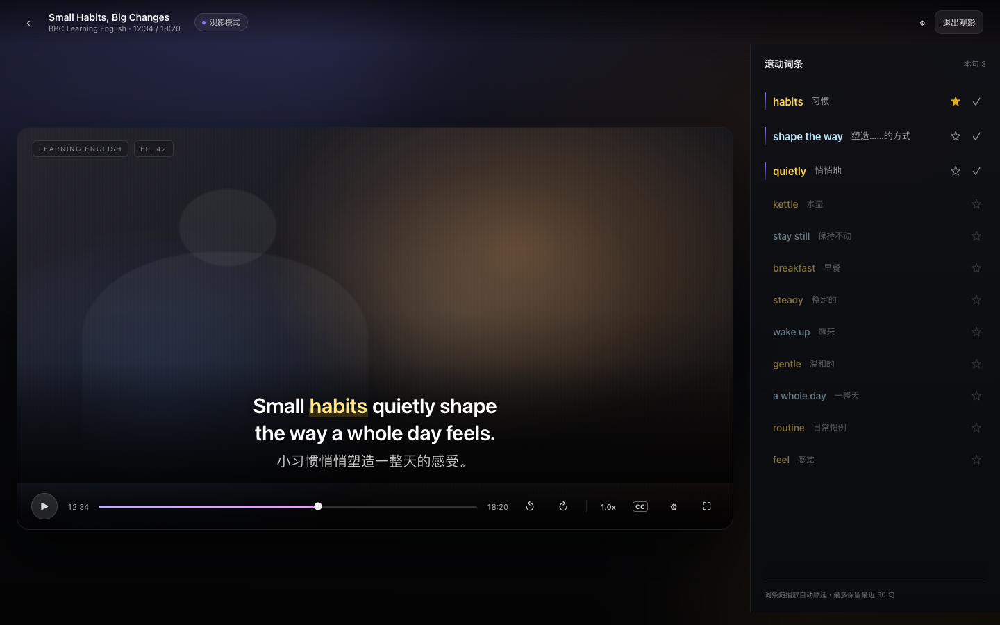
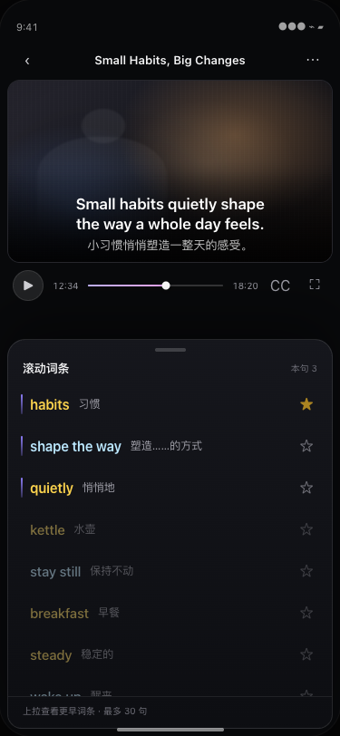
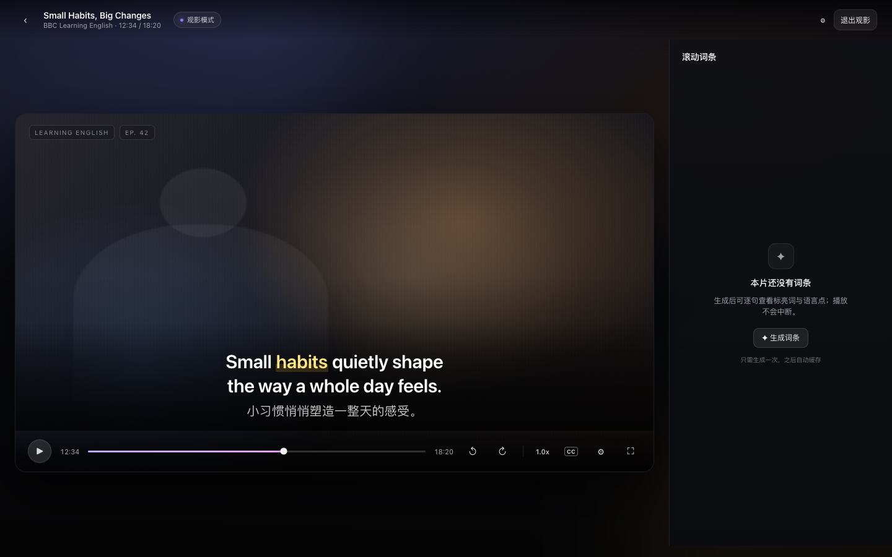
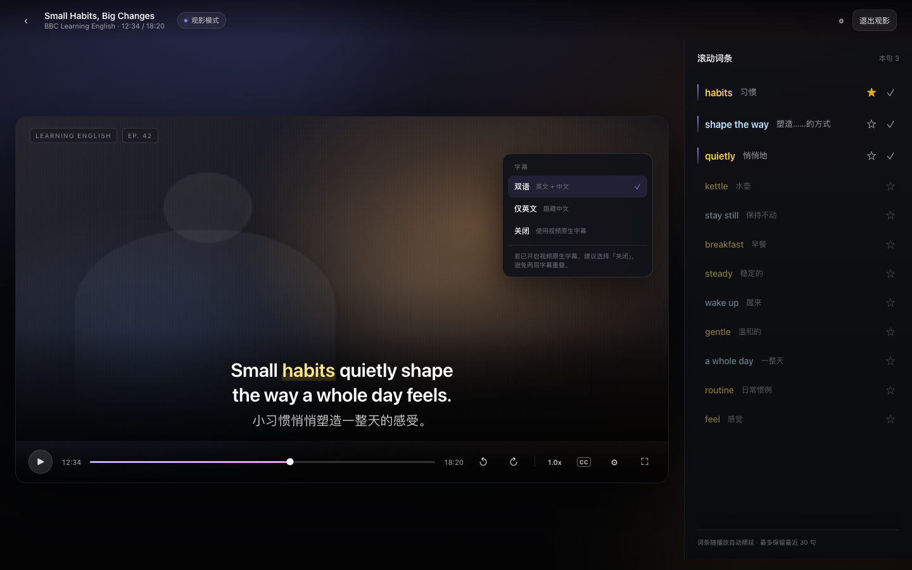

# 观影模式 · 体验设计稿

> 对应规格：[specs/045-watch-mode-experience/spec.md](../../../specs/045-watch-mode-experience/spec.md)
> 状态：待用户确认视觉方向；确认前不改 `frontend/`。

## 目标稿

| 场景 | 图 |
|---|---|
| 1440 桌面 |  |
| 375 移动 |  |
| 无分析空态 |  |
| 字幕模式弹出 |  |

可交互预览：用浏览器打开 `index.html?state=desktop`、`?state=mobile`、`?state=empty`、`?state=subtitle`。

## 与当前实现的关键差别

| 维度 | 当前 | 目标 |
|---|---|---|
| chrome | 顶栏 + LearningHeader 常驻 | 只有浮层顶部条，2.5s 自动淡出 |
| 舞台 | 视频靠上，下方大片死黑 | 视频居中，环境光填充黑边，画面即页面 |
| 字幕 | 通栏实色黑带、固定字号 | 下缘渐变 scrim、英文主/中文辅、随容器缩放；可切换双语/仅英文/关闭 |
| 词条栏 | 345px、单行词、下面全空 | 360px、当前句 3 条 + 历史渐隐、操作 hover 出现 |
| 空态 | 空白 | 一条说明 + 生成按钮，不铺满 |
| 移动端 | 视频小、字幕占一半、右上浮窗 | 16:9 视频 + 常驻控制条 + 底部词条抽屉 |
| 退出 | 画面中央浮按钮 | 顶部浮层「退出观影」+ Esc/全屏分层 |

## 字幕与原生字幕共存

很多视频自带原生字幕，原生断句/位置/样式通常更好；我们的双语字幕是增强，不是替代。控制条 `CC` 提供三态：

- **双语**：英文 + 中文（默认）
- **仅英文**：隐藏中文，保留逐句同步
- **关闭**：不渲染我们的覆盖层，使用视频原生字幕；词条栏仍可用

不尝试读取/控制 iframe 的原生 CC 状态；当原生字幕开启时，选「关闭」即可避免双英文字幕叠加。偏好持久化，切换不重载播放器。

## 设计决策（为什么）

1. **黑边不是空白，是影院构图**：用极暗环境光/模糊画面填充，视觉上仍以视频为中心。
2. **字幕不属于 UI 面板**：不用实色横条，改用下缘渐变 scrim；字号/位置是学习工具的基本控制。
3. **词条是“随句流动”的辅助**：默认只给当前句目标；历史降透明度，不做分组标题/边框/分割线；无分析时给单一行动，不制造空白焦虑。
4. **移动端不是桌面缩水**：视频 16:9 + 控制条常驻 + 词条底部抽屉；手指可达，不遮挡画面。
5. **模式要有层级**：进入/退出、全屏/退全屏、设置/字幕都有明确层级；不把全屏当观影。
6. **状态完整**：加载/无分析/失败/未登录/空句/游客都设计；播放永远不被分析阻塞。

## 实现顺序（确认后）

1. 壳层/舞台（隐藏 chrome、居中、环境光、桌面/移动）
2. 字幕（字体、scrim、位置、设置、缩放）
3. 词条栏/抽屉（历史、操作、空态）
4. 控制条/键盘/状态
5. 可访问性与 375/768/1440/1920 验收
6. 连续观看 10 分钟与指标

## 非目标

弹幕、评论、画中画、投屏、字幕下载、逐词 karaoke、自动进入观影、书籍复用。
